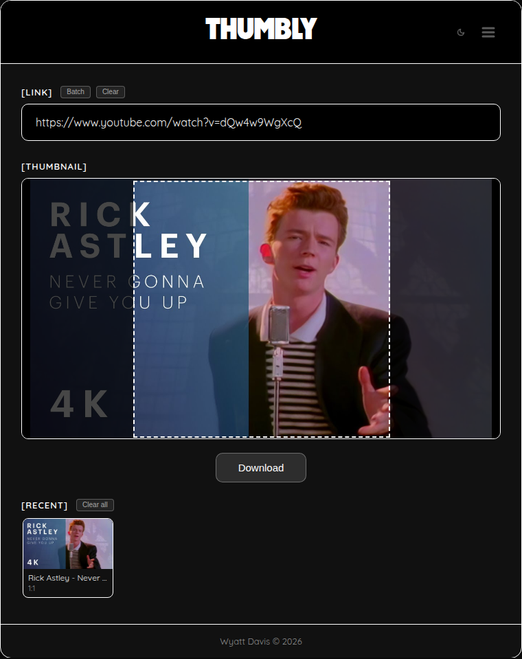
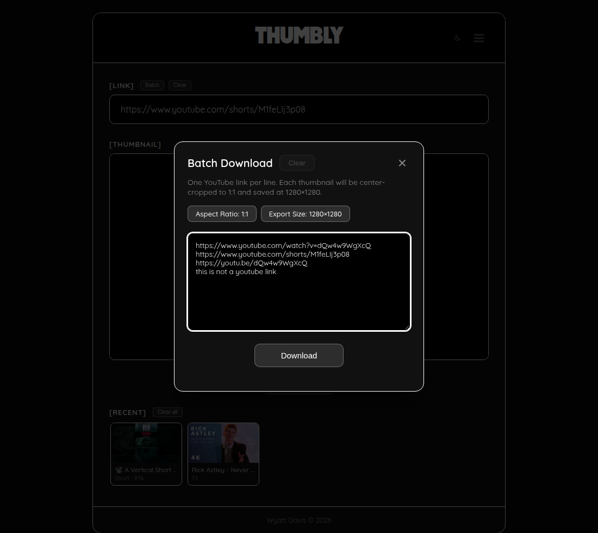
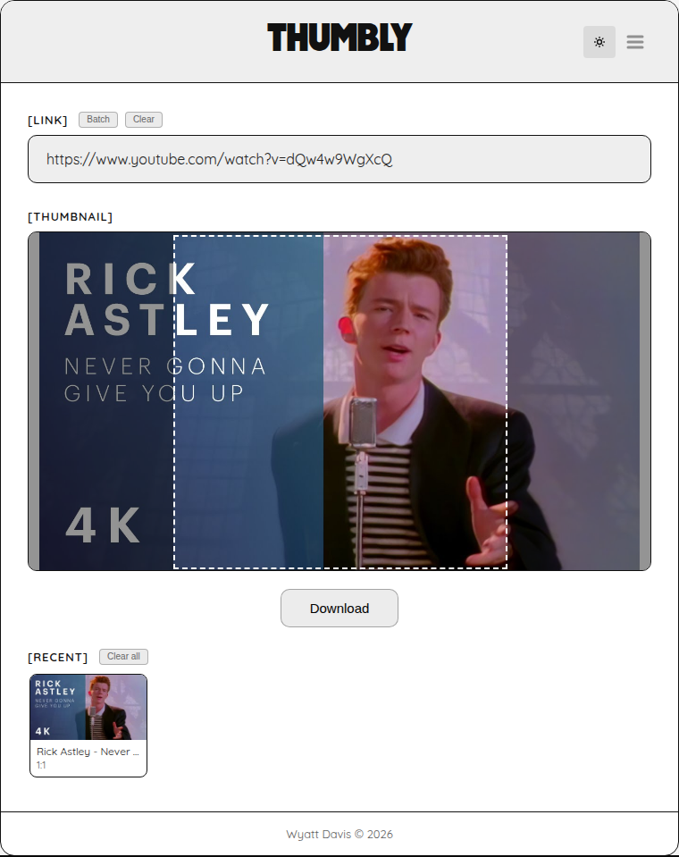

  

<h1 align="center">Thumbly</h1>

  Crop and download YouTube thumbnails in your browser.

  
  

  <a href="https://wyatt-davis.github.io/Thumbly/"><strong>Open the live app</strong></a>

Paste a YouTube link. Thumbly loads the best thumbnail it can find, lets you frame a crop, and saves a JPEG. There is no account and no upload.

<table>
  <tr>
    <td></td>
    <td></td>
    <td></td>
  </tr>
  <tr>
    <td align="center">Main view</td>
    <td align="center">Batch download</td>
    <td align="center">Light mode</td>
  </tr>
</table>

## Features

- Normal videos, Shorts, Live links, `youtu.be` links, embed links, and a bare 11-character video ID.
- Drag a crop at **16:9**, **9:16**, or **1:1**. **Original** keeps the thumbnail's own size and does not scale it.
- Export sizes for cropped ratios: 512, 1024, 1280 (the default), or 1920 on the long side.
- Shorts open at 9:16. Other links open at 1:1.
- Batch mode saves many links as one zip. JSZip is included in the page.
- A recent list that remembers the ratio and crop.
- Filename templates, light and dark themes, and keyboard shortcuts.

## How to use

### On the website

1. Open [wyatt-davis.github.io/Thumbly](https://wyatt-davis.github.io/Thumbly/).
2. Paste a YouTube link. The thumbnail loads on its own.
3. Drag the frame if you want a different part of the picture. **Re-center** puts it back in the middle.
4. Open the menu (top right) to change the shape, the export size, or the filename.
5. Click **Download**.

The sun/moon button switches between dark and light.

### One file, no install

- On the site, open the menu and choose **Download HTML**, then open `Thumbly.html`.
- Or download [thumbly.html from the v1.0.0 release](https://github.com/Wyatt-Davis/Thumbly/releases/download/v1.0.0/thumbly.html) and open it.
- Or save [`index.html`](index.html) from this repository (**Raw**, then **Save as**) and open it.

Fetching a thumbnail needs a network connection. A lone downloaded HTML file still runs if the favicon files are not beside it.

## Keyboard shortcuts

Single-letter shortcuts are ignored while you are typing, while a dialog is open, or while Ctrl, Cmd, or Alt is held.

| Key | Action |
| --- | --- |
| Enter | Download the current thumbnail, when the link box is focused or nothing is focused. |
| Enter | In the filename dialog, save the template. |
| Esc | Close the open dialog, or close the menu. |
| B | Open batch download. |
| R | Re-center the crop, when a video is loaded. |
| C | Clear the link and the preview. |
| Tab | Move through an open dialog. Shift+Tab moves backward. |

## Privacy

Thumbly runs in your browser. It has no server and no account.

- Thumbnail images come from YouTube (`img.youtube.com` and `i.ytimg.com`).
- The title and channel name come from [noembed.com](https://noembed.com/).
- Theme, export size, aspect ratio, filename pattern, and the recent list stay in this browser's `localStorage` (`thumbly-theme`, `thumbly-export-size`, `thumbly-aspect`, `thumbly-filename-template`, `thumbly-recent`).
- A recent entry stores the video ID, title, ratio, crop position, and a thumbnail URL.

YouTube and noembed see those requests. If storage is blocked, the page still runs and forgets settings when you leave.

## License

[MIT](LICENSE) © 2026 [Wyatt Davis](https://github.com/Wyatt-Davis).

JSZip 3.10.1 is dual-licensed MIT and GPLv3 and is used here under MIT. The copy includes pako, which is MIT. Details are at the bottom of the license file.
